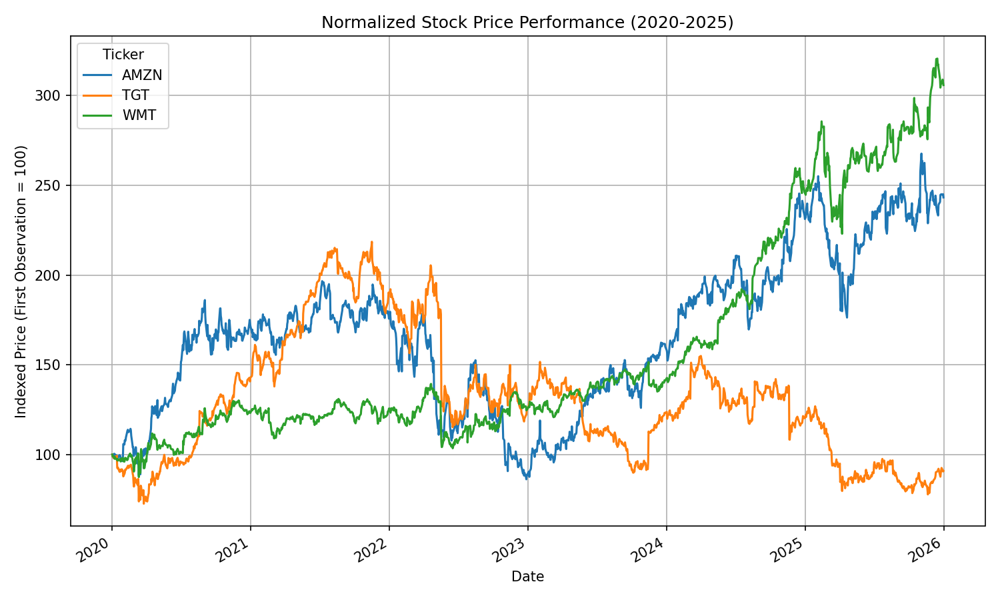
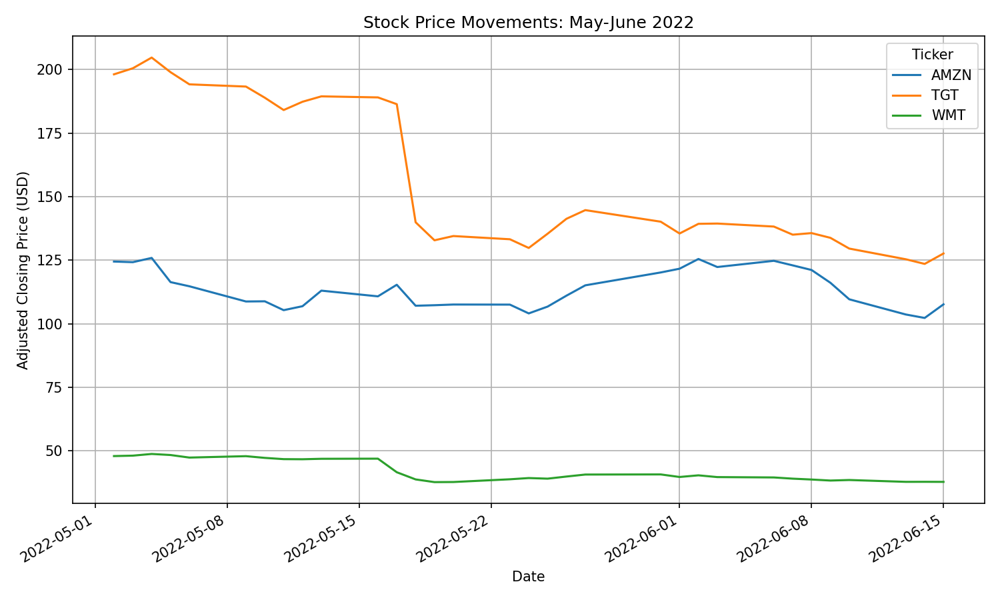
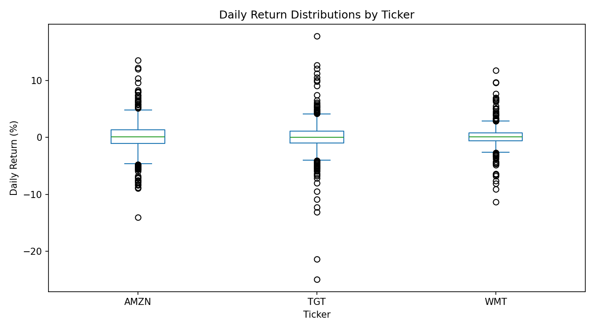
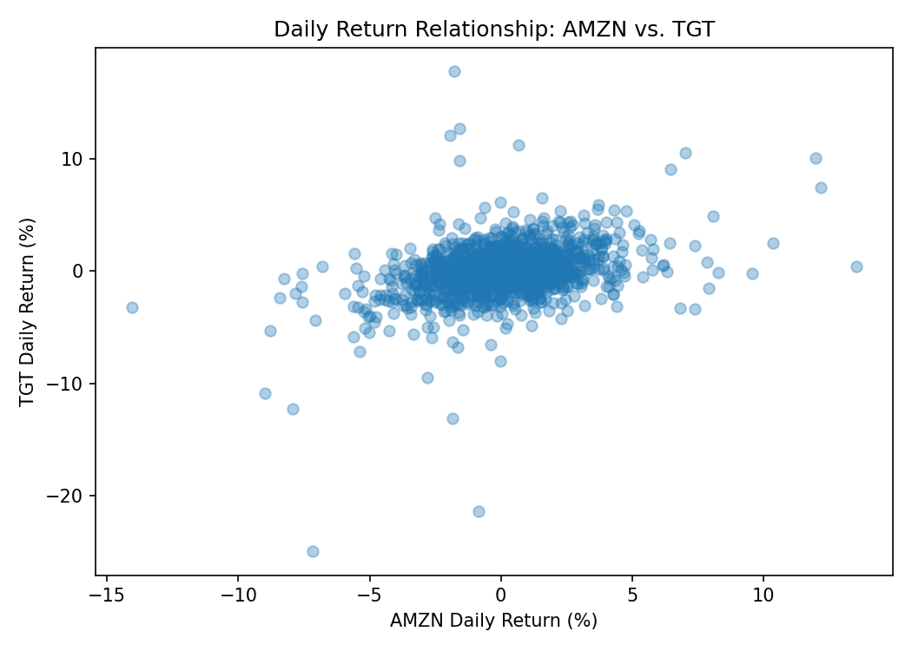

# amazon-target-walmart-stock-analysis

## Group Members
Winnie(Yuxi Zhang), Faith, Jodiann

## Companies and Tickers
- Amazon: AMZN
- Target: TGT
- Walmart: WMT

## Analysis Period
January 1, 2020, to December 31, 2025.

## Business Question
How did the stock performance of Amazon, Target, and Walmart differ from 2020 to 2025, and what business events may explain their significant price movements?

## Reason for Stock Selection
Amazon, Target, and Walmart compete in the retail industry but differ in their business models and customer segments. Amazon has a strong focus on e-commerce and cloud computing, while Target and Walmart rely heavily on retail stores alongside their online operations. Comparing these companies helps us investigate how stock performance responds to company-specific events and shared market conditions.

## Tools and Libraries
Python: Data analysis and calculations
yfinance: Historical stock market data collection
pandas: Data cleaning, grouping, descriptive statistics, and correlation analysis
Matplotlib: Stock price and return visualizations
GitHub: Version control and team collaboration

## Setup and Installation
To reproduce this analysis:

1. Install Python 3 and Git.

2. Clone the repository:

   ```bash
   git clone https://github.com/Winnie-Yuxi/amazon-target-walmart-stock-analysis.git
   ```

3. Open the repository folder:

   ```bash
   cd amazon-target-walmart-stock-analysis
   ```

4. Install the required libraries:

   ```bash
   python3 -m pip install -r requirements.txt
   ```

5. Run the analysis:

   ```bash
   python3 stock_analysis.py
   ```

An internet connection is required to download the data.
The script generates charts and CSV summary tables.


## Item 1: Data Collection
Stock price data for Amazon, Target, and Walmart was successfully collected from 2020 to 2025. This data provides the foundation for comparing the performance of the three companies.

## Item 2: Data Inspection
The dataset was reviewed to confirm that the data was complete, organized, and ready for analysis.

## Item 3: Return Analysis and Correlation
The correlation matrix shows that Amazon, Target, and Walmart had positive correlations, meaning their stock returns generally moved in the same direction. The strongest relationship was between Target and Walmart (0.409), while Amazon and Walmart had the weakest correlation (0.291). 

## Item 4: Monthly and Annual Average Closing Price Summary
We used pandas `groupby()` and `resample()` to calculate the monthly and annual average adjusted closing prices of Amazon, Target, and Walmart from 2020 to 2025.
The results reveal different long-term trends. Amazon experienced a noticeable decline in 2022 followed by a recovery, while Walmart showed a generally upward trend in later years. Target experienced significant fluctuations and weaker performance toward the end of the analysis period.
These findings help us compare the companies' historical stock price trends and understand how their performance differed over time.
The complete monthly and annual summary tables are available in the 'outputs_group_assignment' folder.

## Item 5: Significant Stock Movements and Business Events

### Overview

Our analysis identified significant daily stock price movements for Amazon (AMZN), Target (TGT), and Walmart (WMT) between 2020 and 2025. We focused on three major declines in April and May 2022 to investigate how financial performance, rising operating costs, and inflation affected investor confidence.

### Amazon (AMZN) — April 29, 2022

Amazon experienced a significant daily return of **-14.05%** on April 29, 2022. This decline followed the company's disappointing first-quarter earnings report. Amazon faced rising operating costs, slower growth, and concerns about its future profitability. The company also reported a quarterly net loss, partly related to its investment in Rivian.

These results raised investor concerns about Amazon's ability to maintain strong profitability during a period of economic uncertainty.

### Walmart (WMT) — May 17, 2022

Walmart experienced a daily return of **-11.38%** on May 17, 2022. The company reported a decline in quarterly earnings and lowered its annual profit forecast.

Rising fuel, transportation, and labor costs reduced profitability. At the same time, inflation affected consumer purchasing behavior, as customers increasingly focused on essential products with lower profit margins.

This event demonstrates how increasing operating expenses can negatively affect a retailer's profitability and stock performance.

### Target (TGT) — May 18, 2022

Target experienced a sharp daily return of **-24.93%** on May 18, 2022, representing its largest daily decline in our dataset.

The company reported that its first-quarter profit had fallen by approximately half. Higher transportation and fuel costs, along with inflation-related pressures, significantly reduced its profit margins.

Investors reacted negatively to the disappointing earnings results and concerns about future profitability, leading to a major decline in Target's stock price.

### Business Analysis and Conclusion

These three events demonstrate how inflation, rising operating costs, and disappointing financial results can affect stock prices.

Walmart and Target experienced particularly significant declines on consecutive trading days in May 2022, suggesting that both companies faced similar challenges in the retail industry.

Amazon also experienced a major decline during the same broader period of economic uncertainty, although its business model and financial challenges differed from those of Walmart and Target.

Overall, our findings suggest that investors should consider not only revenue growth but also operating costs, profitability, and broader economic conditions when evaluating companies.

### References
1. Amazon.com, Inc. (2022, April 28). *Amazon.com Announces First Quarter Results.* [Amazon Investor Relations](https://ir.aboutamazon.com/news-release/news-release-details/2022/Amazon-com-Announces-First-Quarter-Results-f0188db95/)
2. Walmart Inc. (2022, May 17).
   *Walmart Releases Q1 FY23 Earnings.*
   https://corporate.walmart.com/news/2022/05/17/walmart-releases-q1-fy23-earnings
3. Target Corporation. (2022, May 18).
   *Target Corporation Reports First Quarter Earnings.*
   https://corporate.target.com/press/release/2022/05/target-corporation-reports-first-quarter-earnings

## Item 6: Stock Price Visualizations

### Figure 1: Normalized Stock Price Performance (2020–2025)



This chart compares the relative stock price performance of Amazon, Target, and Walmart over the full analysis period, helping investors identify differences in long-term growth.

### Figure 2: Stock Price Movements (May–June 2022)



This chart focuses on the significant stock price declines of Walmart and Target in May 2022, highlighting the impact of earnings disappointments and rising operating costs on major retailers.

### Figure 3: Daily Return Distributions



This box plot compares daily return volatility across the three stocks, showing that Amazon and Target experienced greater fluctuations than Walmart during the analysis period.

### Figure 4: Daily Return Relationship Between AMZN and TGT



This scatter plot shows a positive but relatively weak relationship between Amazon and Target's daily returns (r = 0.359), helping investors understand the degree to which their stock movements are related.

## Item 7: Final Summary

### Research Overview

This project investigated the stock performance of Amazon, Target, and Walmart from 2020 to 2025. Using historical adjusted stock prices, daily returns, descriptive statistics, correlations, and visualizations, we compared their long-term performance and examined significant movements associated with business events.

Our analysis combined quantitative stock data with company financial announcements to explore how profitability, operating costs, and broader economic conditions may influence investor reactions.

### Key Findings

**Finding 1: Walmart had the lowest daily return volatility.**

Walmart's daily return standard deviation was approximately 1.45%, compared with 2.25% for Amazon and 2.24% for Target. Walmart's average daily return was approximately 0.085%, similar to Amazon's 0.084% and higher than Target's 0.019%.
These results suggest that Walmart experienced relatively stable historical daily returns during the study period.

**Finding 2: Target and Walmart had the strongest daily return correlation.**

The correlation between Target and Walmart was 0.409, compared with 0.359 between Amazon and Target and 0.291 between Amazon and Walmart.
This suggests that Target and Walmart were more closely related in their daily stock movements, potentially reflecting their exposure to similar retail industry conditions. However, correlation does not establish causation.

**Finding 3: Earnings announcements were associated with major stock price declines.**

Amazon declined 14.05% on April 29, 2022, Walmart declined 11.38% on May 17, 2022, and Target declined 24.93% on May 18, 2022.
These movements coincided with disappointing financial results and concerns about profitability, illustrating the importance of monitoring earnings reports and operating expenses.

**Finding 4: Long-term performance differed significantly across the three companies.**

The annual average adjusted closing prices showed that Amazon recovered after its 2022–2023 weakness, Walmart generally strengthened in later years, and Target experienced a decline from its earlier highs.
These differences suggest that companies within the same industry can experience different market outcomes because of their business models, operating performance, and investor expectations.

### Limitations and Open Questions
This analysis has several limitations.
First, historical stock prices and correlations cannot establish direct causal relationships between financial announcements and market movements.
Second, the study covers only three companies and the 2020–2025 period, so its findings may not apply to other companies or time periods.
Third, daily adjusted closing prices do not capture intraday price movements. Correlation analysis also measures only linear relationships and does not fully explain differences in company fundamentals.
Future research could examine how interest rates, consumer spending, e-commerce growth, and changes in operating margins affect retail stock performance.

### Conclusion and Business Implications
Our analysis demonstrates that Amazon, Target, and Walmart experienced different stock price trends despite operating in related markets.
The significant declines in April and May 2022 highlight how inflation, rising operating costs, and disappointing financial results can affect investor confidence.
For investors and business analysts, these findings emphasize the importance of evaluating profitability, volatility, and company-specific financial performance rather than relying only on stock price movements or revenue growth.

### References
1. Amazon.com, Inc. (2022, April 28). *Amazon.com Announces First Quarter Results.* [Amazon Investor Relations](https://ir.aboutamazon.com/news-release/news-release-details/2022/Amazon-com-Announces-First-Quarter-Results-f0188db95/)
2. Walmart Inc. (2022, May 17).
   *Walmart Releases Q1 FY23 Earnings.*
   https://corporate.walmart.com/news/2022/05/17/walmart-releases-q1-fy23-earnings
3. Target Corporation. (2022, May 18).
   *Target Corporation Reports First Quarter Earnings.*
   https://corporate.target.com/press/release/2022/05/target-corporation-reports-first-quarter-earnings

### Reproducibility and Data Notes
This project uses historical market data downloaded through yfinance. The analysis requires an internet connection when retrieving data.
Historical adjusted prices may be revised by the data provider, and results may change slightly if the source data or software versions change.
The repository includes the Python analysis script, dependency list, generated visualizations, and summary CSV files.

